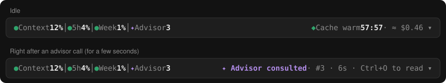
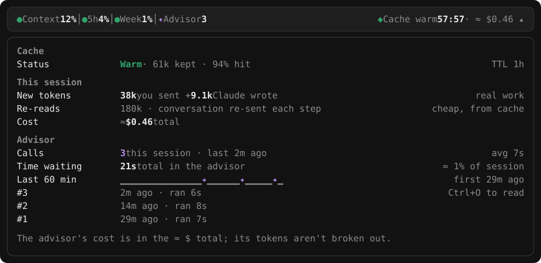

# status-band

A Claude Code mod that puts one plain status line above the prompt:

```
● Context 12% │ ● 5h 4% │ ● Week 1% │ ✦ Advisor 3        ◆ Cache warm 57:57 · ≈ $0.46  ▾
```

## Preview

The band, idle and right after an advisor call:



Opened with `/band`:



*These are illustrations of the band, drawn with sample numbers, not screenshots.*

## What it shows

- **Gauges:** context window, 5-hour limit and weekly limit, colored green / amber / red.
- **Right side, one thing at a time:** a warning when something needs attention, otherwise the advisor note, the live new-token rate while Claude works, or the prompt-cache countdown and session cost.
- **Advisor (`✦ Advisor N`):** shows once the advisor has been consulted. For a few seconds after a call it reads `✦ Advisor consulted · #3 · 6s`.
- **Details:** `/band` (or the `▾` button) opens limits, cache, session token totals and an Advisor section with call count, time spent, a 60-minute trail and the last calls.
- `/band hide` and `/band show` turn the band off and on.

## Settings

Everything on the band can be switched on or off; all options are on by default.

| Option | What it controls |
| --- | --- |
| `showContext` | Context gauge |
| `show5h` | 5-hour limit gauge |
| `showWeek` | Weekly limit gauge |
| `showAdvisor` | Advisor count, the "Advisor consulted" note and the Advisor section in the details |
| `showCache` | Cache countdown on the right |
| `showCost` | Every `≈ $` figure, on the band and in the details |
| `showRate` | Live new-token rate while Claude works (off: the cache countdown shows instead) |
| `showAlerts` | Warnings: context nearly full, a limit running out, the cache about to expire |
| `detailsNow` | Details section "Right now" |
| `detailsLimits` | Details section "Limits" |
| `detailsCache` | Details section "Cache" |
| `detailsSession` | Details section "This session" |
| `advisorFlashSeconds` | Seconds the band says "Advisor consulted" after a call (default 12, `0` turns the note off) |

Change them in any of three ways. A change reloads the mod.

- **In a session, with `/band`** (works in the desktop app too):

  ```
  /band settings
  /band set showCost off
  /band set advisorFlashSeconds 30
  ```

  Values are `on` / `off` for switches and a number for `advisorFlashSeconds`.
- **In `/config`**, where each option is a row (terminal sessions).
- **In `settings.json`**, under `pluginConfigs`:

  ```json
  {
    "pluginConfigs": {
      "status-band": { "options": { "showCost": false, "showRate": false } }
    }
  }
  ```

  The key is the plugin's name. If a marketplace install doesn't pick it up, use `/band set` instead.

If every item on the band is off, the band draws no row at all; `/band` still opens the details, and `/band hide` hides everything.

## Install

You need a Claude Code build that supports mods (written and tested on 2.1.299). In a terminal session:

```
/plugin install status-band --marketplace sertacdincel-byte/claude-status-band
```

Answer `y` to add the marketplace, then pick a scope. From a shell:

```
claude plugin install status-band --marketplace sertacdincel-byte/claude-status-band
```

This repository is private, so GitHub access must be set up on your computer (for example `gh auth login`, or an SSH key on an account that has been invited to the repository). Restart Claude Code after installing.

### Install from a folder instead

Clone the repository, then either run once with

```
claude --plugin-dir <path-to-clone>
```

or load it every time by adding the folder to `~/.claude/settings.json` (several folders are separated by `;`):

```json
{
  "env": {
    "CLAUDE_CODE_PLUGIN_DIRS": "C:/path/to/claude-status-band"
  }
}
```

## What it can and can't show about the advisor

The API reports an advisor call's name, start and end, so the band shows the call count, how long each call ran and when. It does not report the advisor's tokens or whether it "reviewed" or "declined". The advisor's cost is in the `≈ $` total; its tokens aren't broken out.

The band updates when the step that carried the call comes back, not while the advisor is running, so "Advisor consulted" is after the fact. The `Ctrl+O to read` hint appears on the terminal surface only.

## Develop

```
claude plugin validate .
claude plugin test .
```

`hooks/register.tsx` is the whole mod, `hooks/register.test.ts` its tests, `types/index.d.ts` the contract for the values it keeps.

## Türkçe özet

Prompt'un üstünde tek satırlık durum bandı: context, 5 saatlik ve haftalık limit, cache geri sayımı ve advisor çağrı sayısı. Kurulum için yukarıdaki `/plugin install` satırını kullanın; depo private olduğu için GitHub erişiminiz olmalı. Kurduktan sonra Claude Code'u yeniden başlatın. Detaylar için `/band`.
